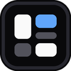

<div align="center">
  
  <h1>GridWise</h1>
  <p>
    <strong>Modern Timetable UI Studio</strong> — Build conflict-free weekly schedules, preview 12 handcrafted architectural templates, import via AI, and export print-ready PNG, PDF, .ICS, and daily poster packs.
  </p>

  <p>
    <a href="https://gridwise-umber.vercel.app"><strong>Live Demo</strong></a> ·
    <a href="https://github.com/agnelfranciso/gridwise"><strong>Repository</strong></a> ·
    <a href="https://gridwise-umber.vercel.app/legal"><strong>Terms & Privacy</strong></a>
  </p>

  <p>
    
    
    
    
    
    
  </p>
</div>

---

## Features

- **Guided 2-Step Onboarding (`OnboardingWizard`)** — Enter subjects, course codes, rooms, instructors, and exact weekly timings, or import directly with AI, then preview live across 12 templates.
- **Automatic Overlap Detection & Smart Merge** — Detects scheduling conflicts in real time (`schedule-engine.ts`) and lets you merge intentional parallel/lab sessions into unified split cards.
- **AI Schedule Import (`ImportAiModal`)** — Copy a structured prompt to use with ChatGPT, Claude, or Gemini on any schedule image, PDF, or text, then paste the JSON output for local client-side parsing (`import-parser.ts`) and instant theme selection.
- **12 Structurally Distinct Design Presets (`themes.ts`)** — Each preset pairs custom typography (`Inter`, `Geist`, `Plus Jakarta Sans`, `Space Grotesk`, `DM Sans`, `Newsreader`, `Syne`, `Outfit`, `IBM Plex Mono`, `JetBrains Mono`), bespoke layouts, and light/dark palettes.
- **Multi-Format Client-Side Exports** —
  - **2× Retina PNG** (single weekly timetable or individual day poster)
  - **All Days (`.ZIP`)** via `jszip` for daily poster presets
  - **Direct `.PDF` Download** via `jspdf` (including multi-page daily PDFs)
  - **`.ICS` Calendar** export for Apple Calendar, Google Calendar, and Outlook
  - **`.JSON` Backup** for portable schedule backups
- **Google OAuth & Cloud Sync** — Passwordless Google Sign-In (`/signin`), post-onboarding `LoginGate` with automatic draft preservation, private cloud library, and PII-free public share links (`/share/[id]`).
- **Self-Serve Account Controls (`/account`)** — Export all saved schedules as JSON, delete all saved content and revoke share links, or permanently delete your account.

---

## 12 Preset Templates

| Preset | Category | Layout Style | Mode |
| :--- | :--- | :--- | :--- |
| **Cron Studio** | Calendar + Analytics | Proportional Grid + Breakdown Rail | Dark |
| **Swiss Timeline** | Horizontal Axis | Left-to-Right Gantt | Dark |
| **Sapphire Bento** | Bento Dashboard | Cobalt Metric Widgets + Day-Tile Grid | Dark |
| **Editorial Journal** | Magazine Spread | Course Index + Structured Spread | Dark |
| **Linear Boards** | Day Columns | Chronological Task Columns | Dark |
| **Terminal Index** | Structured Console | Developer Console Table | Dark |
| **Gallery Paper** | Editorial Light | Warm Archival Light Grid | Light |
| **Violet Poster** | Gradient Poster | Floating Glass Columns | Dark |
| **Precision Run** | Editorial Columns | Matte Charcoal Bold Columns + Ice-Cyan Highlights | Dark |
| **Acid Daily** | Per-Day Poster | Concrete Grey & Acid-Lime Daily Carousel | Dark |
| **Ivory Daily Deck** | Per-Day Poster | Warm Paper Daily Schedule Cards | Light |
| **Exhibition Blue** | Per-Day Poster | Cornflower Blue Exhibition Hairline Poster | Light |

---

## Tech Stack & Project Structure

- **Framework:** Next.js 16.4.6 (App Router, Turbopack, Cache Components)
- **UI & Motion:** React 19, Tailwind CSS v4, `motion/react`, `lucide-react`
- **Exports:** `html-to-image`, `jspdf`, `jszip`
- **Auth & Cloud Storage:** Firebase Authentication (Google OAuth) & Cloud Firestore (`firestore.rules`)

```text
src/
├── app/
│   ├── account/        # Account settings, JSON backup, content & account deletion
│   ├── legal/          # Terms of Service, Privacy Policy & Data Controls
│   ├── share/[id]/     # Public read-only timetable viewer + Remix in Studio
│   ├── signin/         # Dedicated Google OAuth sign-in page
│   ├── layout.tsx      # Root layout, Google Fonts, MotionProvider & SEO metadata
│   ├── page.tsx        # Main entry rendering GridWiseStudio
│   ├── robots.ts       # Crawler rules (/robots.txt)
│   └── sitemap.ts      # Dynamic XML sitemap (/sitemap.xml)
├── components/
│   ├── GridWiseStudio.tsx
│   ├── OnboardingWizard.tsx
│   ├── TimetableRenderer.tsx
│   ├── SubjectEntryBuilder.tsx
│   ├── WelcomeLanding.tsx
│   ├── LoginGate.tsx
│   ├── SignInPage.tsx
│   ├── AccountSettingsPage.tsx
│   ├── ImportAiModal.tsx
│   ├── OverlapAlertModal.tsx
│   └── MotionPrimitives.tsx
├── lib/
│   ├── firebase.ts
│   ├── firestore-timetables.ts
│   ├── schedule-engine.ts
│   ├── import-parser.ts
│   └── themes.ts
└── types/
    └── timetable.ts
```

---

## Local Development

1. **Install dependencies:**

   ```bash
   npm install
   ```

2. **Configure environment variables** in `.env.local`:

   ```env
   NEXT_PUBLIC_FIREBASE_API_KEY=your_api_key
   NEXT_PUBLIC_FIREBASE_AUTH_DOMAIN=your_project.firebaseapp.com
   NEXT_PUBLIC_FIREBASE_PROJECT_ID=your_project_id
   NEXT_PUBLIC_FIREBASE_STORAGE_BUCKET=your_project.firebasestorage.app
   NEXT_PUBLIC_FIREBASE_MESSAGING_SENDER_ID=your_sender_id
   NEXT_PUBLIC_FIREBASE_APP_ID=your_app_id
   ```

3. **Run the development server** (bound to `0.0.0.0` for mobile LAN testing):

   ```bash
   npm run dev
   ```

4. **Lint & production build:**

   ```bash
   npm run lint
   npm run build
   ```

---

## Security & Deployment

- **Security Headers:** Configured in `next.config.ts` (`X-Content-Type-Options`, `X-Frame-Options: DENY`, `Referrer-Policy`, `Permissions-Policy`, and `Strict-Transport-Security`).
- **Firestore Security Rules:** Enforced in `firestore.rules` with strict owner-only isolation on `users/{userId}` and `users/{userId}/timetables/{timetableId}`, input size/schema validation across all 12 template IDs, and PII-free read-only snapshots on `shared_timetables/{shareId}`.
- **Firebase Auth Domains:** Add your production/Vercel domain and any local LAN IP under **Firebase Console → Authentication → Settings → Authorized domains**.
